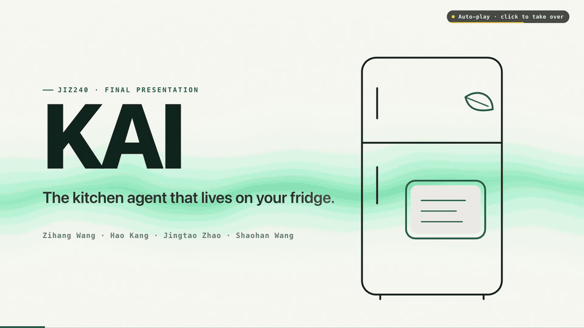
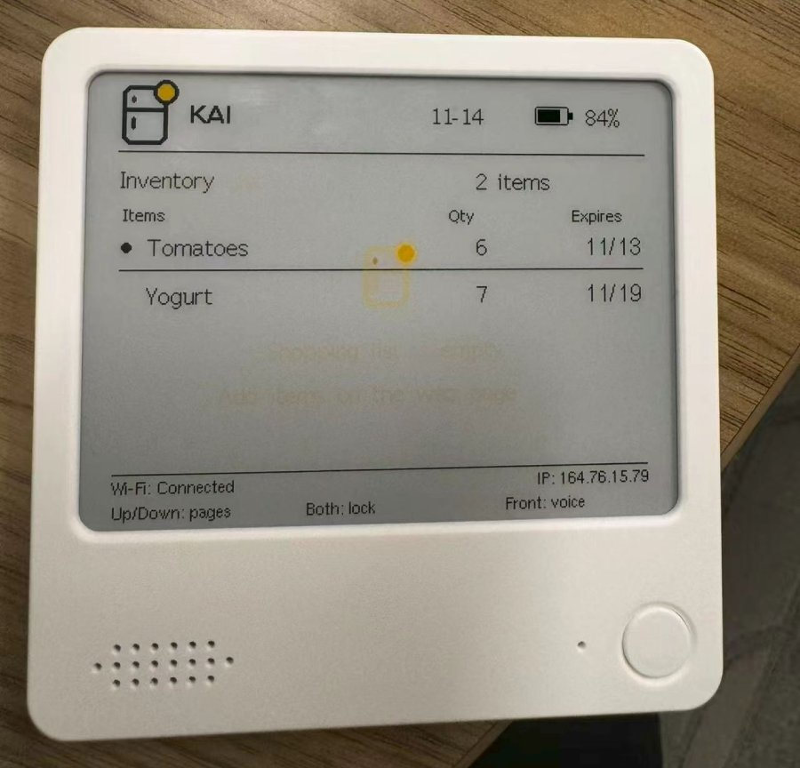
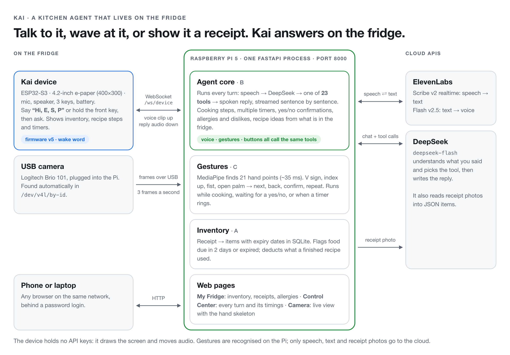
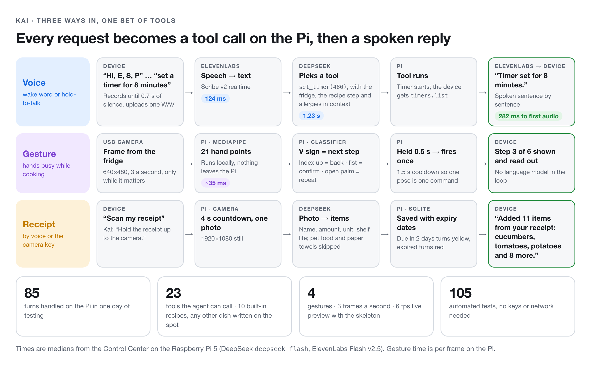
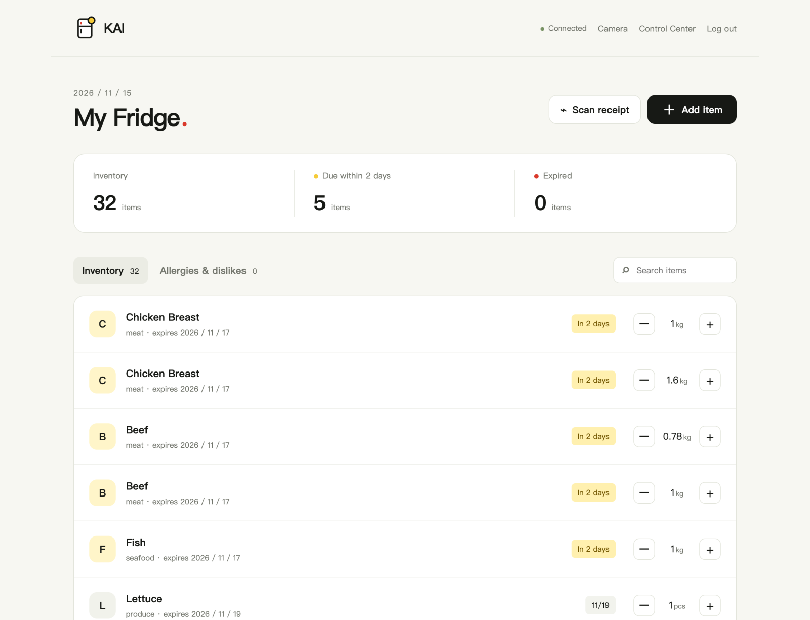
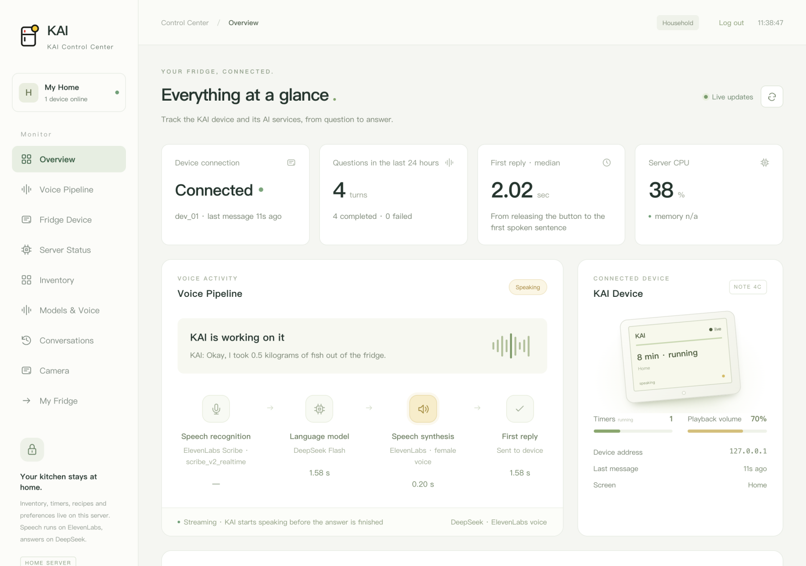

# Kai · a kitchen agent that lives on your fridge

**A small e-paper device on the fridge you can talk to, wave at, or show a receipt. It keeps track of what's in the fridge and when it expires, suggests what to cook, and walks you through the recipe step by step with timers, all answered out loud and on the screen.**

<table>
<tr>
<td width="50%" align="center"><a href="https://youtu.be/Y04v03vnzow"></a><br><b><a href="https://youtu.be/Y04v03vnzow">▶ Watch the intro</a></b> · 2:16 on YouTube</td>
<td width="50%" align="center"><a href="https://haokang-uchicago.github.io/Kai-showcase/presentation/Kai-presentation.html"></a><br><b><a href="https://haokang-uchicago.github.io/Kai-showcase/presentation/Kai-presentation.html">Open the live slides</a></b> · plays by itself; click or use the arrow keys to take over</td>
</tr>
</table>

<table>
<tr>
<td width="42%"></td>
<td>
<p><b>Say</b> <i>“Hi, Kai”</i> (or hold the front key) and ask:</p>
<ul>
<li><i>“What's about to expire in my fridge?”</i></li>
<li><i>“What should I cook tonight?”</i> → <i>“Start it.”</i></li>
<li><i>“Next.”</i> · <i>“Say that again.”</i> · <i>“Set a timer for 8 minutes.”</i></li>
<li><i>“I bought two eggs and a liter of milk.”</i> · <i>“I threw out the fish.”</i></li>
<li><i>“Scan my receipt.”</i> → the camera takes a photo and Kai adds every food item with an expiry date</li>
<li><i>“I'm allergic to peanuts.”</i> → never suggested again</li>
</ul>
<p><b>Hands covered in flour?</b> Show the camera a V sign for the next step, one finger for back, a fist to confirm, an open palm to repeat.</p>
<p><b>On your phone:</b> the same fridge, receipts and allergies in a web page, plus a Control Center that shows every conversation and how long each part took.</p>
</td>
</tr>
</table>

## The idea in one picture

<picture>
  <source media="(prefers-color-scheme: dark)" srcset="assets/architecture-dark.png">
  
</picture>

- **The device is thin.** It draws the screen, records your voice and plays the reply. It holds no API keys and makes no decisions, so the firmware rarely needs to change when the agent gets smarter.
- **One server does the thinking.** A Raspberry Pi 5 runs a single FastAPI process with four parts that call each other in-process: the agent core, gestures, inventory and the web pages.
- **Only speech, text and receipt photos go to the cloud.** ElevenLabs turns speech into text and text back into a voice. DeepSeek understands the request and reads receipts. Gestures are recognised on the Pi itself.

## How a request flows

<picture>
  <source media="(prefers-color-scheme: dark)" srcset="assets/how-it-works-dark.png">
  
</picture>

Voice, gestures and the device's keys all end up calling **the same 23 tools** (`set_timer`, `next_step`, `add_inventory`, `remove_inventory`, `scan_receipt`, `start_recipe`, ...). The language model only chooses the tool and its arguments; the tool does the work and returns a sentence Kai can say. So a timer started by voice and a step changed by a fist behave exactly the same, and the model can never claim something happened when no tool did it.

A few rules that make it feel natural:

- **Kai starts talking before it has finished thinking.** The reply streams out sentence by sentence, so the first audio comes long before the full answer is written.
- **Anything you can't easily undo asks first:** starting a recipe, finishing one (which deducts the ingredients) and clearing the whole fridge. Answer *"yes"* or make a fist.
- **Gestures only run when they are useful:** while cooking, while Kai waits for a yes/no, or while a timer is ringing. Otherwise the camera is off.
- **Recipes:** 10 are built in. Ask for any other dish and Kai writes a full recipe on the spot, with amounts, heat, times and a timer offer on every step that waits, leaving out anything you're allergic to.

## The web pages

All pages sit behind one password (`KAI_WEB_PASSWORD`) and work on a phone.

| My Fridge: inventory, receipts, allergies | Control Center: every turn and where the time went |
|---|---|
|  |  |

There is also a **Camera** page: the live view from Kai's camera at 6 frames a second with the 21-point hand skeleton the gesture model sees, what pose it thinks it is, and the last command it actually sent.

## The device (firmware v5)

The device is a NOTE4C board: **ESP32-S3**, 8 MB PSRAM, 16 MB flash, a **4.2-inch 400×300 black/white/red/yellow e-paper** screen, an ES8311 codec with one microphone and a speaker, three keys and a battery. The firmware is PlatformIO / Arduino and renders every page on the device itself.

**New in v5, now flashed on the device as the current firmware: a wake word.** Say **"Hi, E, S, P"** letter by letter and Kai beeps, lights the LED, shows *Listening...* (unlocking the screen if needed), records until you stop talking and sends the clip to the Pi. Holding the front key still works and always wins.

| | v5 wake word (Espressif WakeNet9 `wn9_hiesp`, esp-sr v1.7.1) |
|---|---|
| Recognised, said letter by letter by a person | **3 / 3**, no false wakes during the session |
| False wakes on 12 look-alike phrases ("Hi Kai", "High speed", ...) | **0 / 12** |
| Time to check one 32 ms frame | **3.05 ms** at 240 MHz (9.5% of a core), **3.73 ms** at 160 MHz |
| Model size, compiled into the app | 291 KB · whole app 2.09 MB, 51% of the OTA slot, partition table unchanged |
| End of speech | 0.7 s of silence (esp-sr VAD); gives up after 2.5 s of nothing, stops at 15 s |
| Echo | Not listening while Kai talks, beeps or an alarm rings, and for 400 ms after |

Measured on the real board in the wake-word bench test; the full design and test log is in our design notes. The run-together "hiesp" does not trigger it; it has to be said as letters. `pio run -d device -e note4c_nowake` builds the old push-to-talk-only firmware for rollback. Still to measure: a 24-hour false-wake run and battery current with the microphone always on.

Point a device at your server once over USB serial (115200 baud); it remembers it:

```text
GATEWAY <pi-ip>:8000
```

## Run it

**Server** (Python 3.11; on the Pi or any computer):

```bash
python3.11 -m venv .venv
.venv/bin/pip install -r server/requirements.txt
cp server/.env.example server/.env      # fill in DEEPSEEK_API_KEY, ELEVENLABS_API_KEY, KAI_WEB_PASSWORD
.venv/bin/python -m server.main         # listens on 0.0.0.0:8000
```

Open `http://<server-ip>:8000/login`. Any API key you leave empty falls back to a stand-in (the model says it isn't connected, speech becomes a beep), so the whole system runs without accounts.

**On the Raspberry Pi**, install it as a service that starts on boot and restarts if it crashes:

```bash
bash deploy/install-pi-service.sh
```

Plug in a USB camera and the server finds it by itself (`/dev/v4l/by-id`); no camera just means no gestures and no receipt photos.

**Tests** (no keys, no network, no hardware; a fake camera and fake cloud services stand in):

```bash
.venv/bin/python -m pytest -q          # 105 passed
```

## How the code is organised

> The source code is in a private repository. This page is the public write-up; feel free to reach out if you would like to see the code.

| Path | What it is | Owner |
|---|---|---|
| `server/agent/` | Agent core: device gateway (WebSocket + audio), voice turns, DeepSeek tool calling, the 23 tools, cooking steps, timers, preferences, camera loop | B |
| `server/inventory/` | Inventory: receipt reading, SQLite store, expiry estimates, deducting used ingredients | A |
| `server/gesture/` | Gestures: MediaPipe hand landmarks → four commands, with debounce | C |
| `server/web/` | Login, My Fridge, Control Center, Camera page | B |
| `device/` | ESP32-S3 e-paper firmware, v5 with the wake word | D |
| `docs/firmware-v5-wakeword-plan.md` | How the wake word was chosen, built and measured | D |
| `docs/interfaces.md` | The one spec all four parts build against: messages, endpoints, tools, behaviour rules | all |
| `docs/gesture_guide.md` | How to make each gesture | C |
| `presentation/` | Final presentation, one self-contained HTML file (served by GitHub Pages) | all |
| `deploy/` | Raspberry Pi service installer | B |
| `server/tests/` | End-to-end tests with a fake device | B |

## Results

| What we measured | Result |
|---|---|
| Turns handled on the Pi in one day of testing | **85** |
| Median speech → text (ElevenLabs Scribe v2 realtime) | **124 ms** |
| Median language model round (DeepSeek `deepseek-flash`) | **1.23 s** |
| Median text → first audio (ElevenLabs Flash v2.5) | **282 ms** |
| Hand landmarks per frame on the Pi 5 | **~35 ms** · preview at 6 fps costs about one of four cores, nothing when nobody watches |
| Receipt test | one photo → **11 items** added with expiry dates, read back out loud |
| Automated tests | **105** passing |

## Things we hit

- **The server only answered itself.** `uvicorn` listens on `127.0.0.1` by default, so the Pi's own browser worked and nothing else on the network could connect. The server now starts on `0.0.0.0`, and every web page and internal API needs a login.
- **It worked until the Pi rebooted.** It had been started as a temporary `systemd-run` unit, which disappears on reboot. `deploy/install-pi-service.sh` installs a real service.
- **"I threw everything out" did nothing.** Kai could add food but had no tool to remove it, so it honestly said it couldn't. Adding `remove_inventory` (with a confirmation before clearing everything) fixed it; the lesson is that the model can only be as capable as its tool list.
- **The camera "stopped working" because it was unplugged.** The kernel log showed a USB disconnect; the setting was fine. Finding the camera by its stable `/dev/v4l/by-id` name means it comes back by itself when replugged.
- **Browsers block the microphone on plain `http://` pages** unless the address is `localhost`. The real device does its own audio, so this only matters for the browser test device at `/sim`.
- **"Hi ESP" has to be spelled out.** The WakeNet model wakes on "Hi, E, S, P" but not on the run-together word, which we only learned by testing with a real person.

## Team

| | Who | Part |
|---|---|---|
| **A** | Zihang Wang | Receipt scanning and inventory |
| **B** | Hao Kang | Agent core, voice, cooking and timers, recipes, web pages, and putting everything together |
| **C** | Jingtao Zhao | Hand gesture recognition |
| **D** | Shaohan Wang | Device firmware and the e-paper screen |

## AI use

- **Claude Code (Claude Opus 5.5)** was a pair programmer for the server: it drafted much of the agent core, the web pages, the tests and this README, and helped debug the Raspberry Pi over SSH. We ran everything on the real device and Pi and decided what to keep.
- **DeepSeek** runs inside Kai: it understands each request and picks a tool, writes recipes that aren't built in, and reads receipt photos.
- **ElevenLabs** does speech to text and text to speech.
